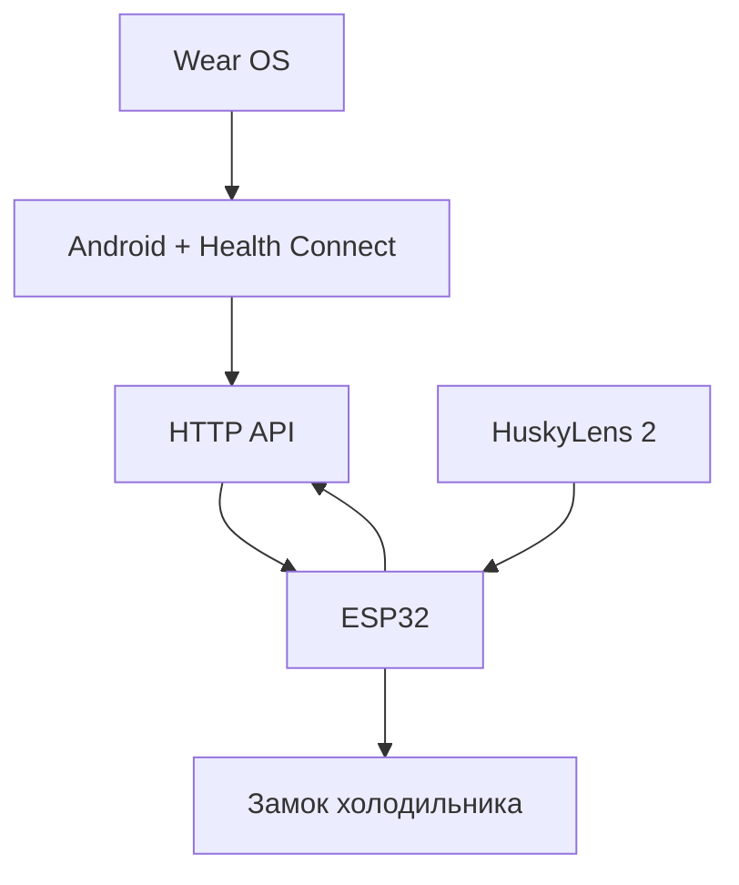

# Ночной Дожор 2.0 — холодильник с персональным доступом

Это отдельный MVP для устройства на ESP32 и HuskyLens 2.

Принятое правило доступа:

- известное лицо проверяется по персональной политике;
- неизвестное лицо считается гостем и сразу получает доступ;
- гость не расходует лимиты, не синхронизируется с часами и записывается как `guest`;
- ESP32 работает автономно по последней сохранённой политике;
- сервер используется для синхронизации профилей, активности и журнала событий.



## Структура

```text
night_dozhor_fridge/
├── server/                 # автономный API без внешних Python-зависимостей
│   ├── app.py
│   ├── requirements.txt
│   └── .env.example
├── device/esp32/           # Arduino-скетч для ESP32 + HuskyLens 2
│   └── FridgeDevice.ino
├── app/android/             # минимальный Kotlin-код чтения Health Connect
│   ├── HealthSync.kt
│   ├── FridgeApiClient.kt
│   └── README.md
├── docs/
│   ├── wiring.md            # соединения и монтаж сверху холодильника
│   └── api.md               # сценарии обмена
└── README.md
```

## Быстрый запуск API

```bash
cd server
python3 app.py
```

По умолчанию API слушает `http://0.0.0.0:8080`, а SQLite-файл создаётся рядом как `fridge.db`. Правила расписания рассчитываются в часовом поясе `Europe/Moscow`, его можно заменить переменной `FRIDGE_TIMEZONE`.

Проверка:

```bash
curl http://127.0.0.1:8080/api/healthz
curl http://127.0.0.1:8080/api/devices/fridge-001/policy \
  -H 'X-Device-Token: demo-device-token'
```

Для устройства задаются `WIFI_SSID`, `WIFI_PASSWORD`, `API_BASE_URL` и `DEVICE_TOKEN` в начале скетча. Для реального сервера токен нужно заменить.

## Сценарий демонстрации

1. Создать пользователя через `POST /api/users`.
2. Запустить `POST /api/enrollment/start`.
3. Обучить лицо на HuskyLens 2 кнопкой `Button-A` на камере. Приложение запускает заявку на обучение, а после физического обучения лицо привязывается к пользователю через API.
4. Завершить привязку через `POST /api/devices/fridge-001/enrollment/complete`.
5. Отправить дневные активные калории через `POST /api/health`.
6. Подойти к камере. `face_id = 0` открывает замок как гость, известный `face_id` проходит локальную проверку политики.

## Синхронизация с Wear OS

Android-приложение получает активные калории через Health Connect после явного разрешения пользователя и отправляет на сервер только суточную сумму. Холодильник напрямую с часами не соединяется. ESP32 получает уже рассчитанную политику по Wi-Fi раз в несколько минут и после событий доступа.

## Ограничение MVP

Текущий замок управляет всей дверцей. Ограничение конкретных продуктов потребует отдельной запираемой секции внутри холодильника, RFID или датчиков веса. В API поле `product_rules` оставлено для следующего этапа.
